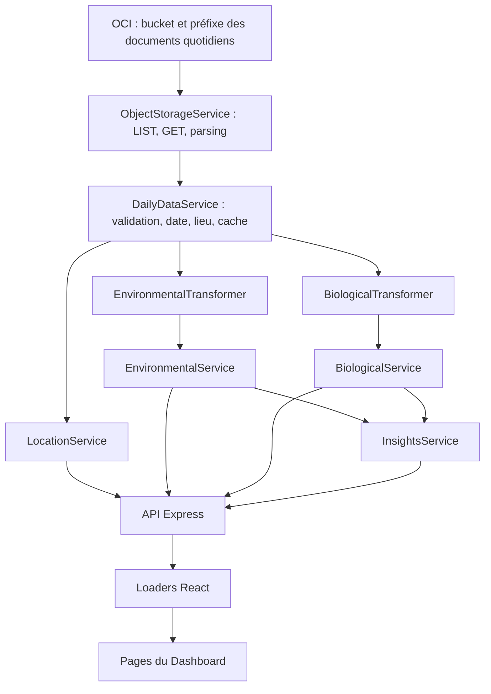

# Architecture de lecture des données quotidiennes

## Objectif et périmètre

Cette architecture cible lit exclusivement les documents quotidiens consolidés. Les fichiers bruts mentionnés dans `source_files` servent à la traçabilité ; le Dashboard ne les télécharge pas.

Un document unique signifie un document par journée et lieu. Plusieurs documents sont nécessaires pour explorer une période ou comparer des villes. L’hypothèse actuelle est une seule série personnelle. Si plusieurs personnes ou appareils produisent des bilans, un identifiant de série devra être ajouté au contrat et aux clés de déduplication.

## Flux



## Structure cible

```text
wildTrace-Dashboard/
├── src/
│   ├── api/dashboardLoaders.js
│   ├── Pages/Environmental.jsx
│   ├── Pages/Biological.jsx
│   ├── Pages/Insights.jsx
│   └── ...
├── server/
│   ├── server.js
│   ├── config/oci.js
│   ├── services/
│   │   ├── objectStorage.js
│   │   ├── dailyDataService.js
│   │   ├── environmentalService.js
│   │   ├── biologicalService.js
│   │   ├── locationService.js
│   │   └── insightsService.js
│   ├── transformers/
│   │   ├── environmentalTransformer.js
│   │   └── biologicalTransformer.js
│   └── utils/statistics.js
├── docs/
├── .env.example
└── README.md
```

## Responsabilités

| Module | Responsabilité |
|---|---|
| `config/oci.js` | Construire le client OCI avec une authentification serveur. |
| `objectStorage.js` | Lister tous les objets du préfixe avec pagination, ne retenir que les JSON, télécharger avec concurrence limitée, parser et conserver le nom de l’objet et ses métadonnées. Aucune extraction métier. |
| `dailyDataService.js` | Valider les documents, résoudre leurs versions, établir date et lieu communs, partager le chargement et le cache. |
| Transformers | Extraire les champs utiles sans inventer de mesures ni remplacer les absences par zéro. |
| `environmentalService.js` | Fournir captures filtrées et résumés quotidiens. |
| `biologicalService.js` | Fournir un bilan biologique par journée et lieu. |
| `locationService.js` | Fournir les lieux distincts et leurs identifiants stables. |
| `insightsService.js` | Calculer les comparaisons avec effectifs, période, critères d’éligibilité et égalités. |
| `statistics.js` | Calculer sur les seules valeurs numériques finies ; retourner `null` si aucune valeur n’est valide. |
| `server.js` | Déclarer les routes, valider les filtres et convertir les erreurs en réponses HTTP. |
| `dashboardLoaders.js` | Appeler l’API, vérifier HTTP, transmettre les données aux pages et permettre l’annulation des requêtes. |

## API cible

Les routes de données renvoient une enveloppe commune :

```json
{
  "data": [],
  "meta": {
    "partial": false,
    "loadedAt": "2026-10-10T10:00:00Z",
    "documentCount": 0,
    "warnings": []
  }
}
```

`loadedAt` indique le chargement par le serveur, pas la date de mesure. Les loaders fournissent `data` aux composants et transmettent séparément les avertissements à l’interface. Cette enveloppe implique d’adapter la route existante qui retourne directement un tableau.

| Route GET | Contenu de `data` |
|---|---|
| `/api/locations` | Lieux distincts présents dans les documents acceptés. |
| `/api/environmental/captures` | Captures normalisées, triées chronologiquement. |
| `/api/environmental/summary` | Résumés par date et lieu, avec effectifs par métrique. |
| `/api/biological/captures` | Bilans quotidiens normalisés. |
| `/api/insights` | Objet de comparaisons et classements, avec métriques et effectifs. |

`GET /api/health` renseigne uniquement la disponibilité du processus serveur. Il ne prouve pas que l’accès OCI fonctionne.

Filtres communs : `from` et `to` au format `YYYY-MM-DD`, bornes inclusives sur la date locale du document ; `locationId` pour un lieu exact. Dates invalides ou plage inversée : HTTP 400. Un identifiant inconnu retourne une liste vide. Les filtres ne changent pas la source OCI.

## Cache et rafraîchissement

- Cache mémoire commun des documents validés ; durée initiale proposée : 60 secondes, configurable.
- Une promesse de chargement commune évite les téléchargements concurrents identiques.
- L’expiration déclenche un nouveau chargement au prochain appel.
- Un échec de chargement ne devient pas une réponse vide réussie et n’est pas mis en cache comme un résultat valide.
- La version initiale ne sert pas silencieusement un ancien cache après une erreur.
- Le cache mémoire est propre à chaque instance du serveur. Une évolution vers un index ou stockage partagé pourra être étudiée si le volume augmente.

## Erreurs et réponses partielles

Une liste OCI inaccessible ou un téléchargement échoué entraîne une erreur HTTP 502, sans détails d’authentification exposés. Une configuration serveur absente entraîne une erreur explicite au démarrage.

Un JSON illisible ou un document structurellement invalide est exclu avec avertissement. Si d’autres documents sont exploitables, `meta.partial` vaut `true` et l’interface signale les données partielles. Si des objets existent mais qu’aucun document n’est exploitable, retourner une erreur ; ne pas présenter cela comme une absence de mesures. Un préfixe réellement vide retourne `data: []`.

Une métrique invalide dans un document utilisable devient `null`, avec avertissement de qualité. Les avertissements publics utilisent des codes et des messages sobres ; les chemins OCI détaillés restent dans les journaux serveur.

## Intégration React

Les pages partagent les mêmes loaders et filtres. Elles distinguent chargement, erreur, données vides, données partielles et données disponibles. Les valeurs `null` apparaissent comme « Données indisponibles » et produisent des interruptions dans les graphiques.

Les données `SAMPLE_*` sont réservées à un mode démonstration explicite. Une erreur API ne déclenche jamais leur affichage automatique. Les cartes, infobulles et axes sont adaptés aux métriques réelles décrites dans le contrat.

## Configuration et déploiement

Le namespace, le bucket et le préfixe sont configurés côté serveur. Les clés OCI et leur chemin ne sont pas transmis à React et ne sont pas placés dans des variables `VITE_*`.

En local, le serveur utilise un profil du fichier OCI. En déploiement, le mécanisme d’identité dépendra de l’hébergement choisi. Le routage `/api`, l’authentification d’accès au Dashboard et l’origine CORS autorisée devront être configurés dans cet environnement.
